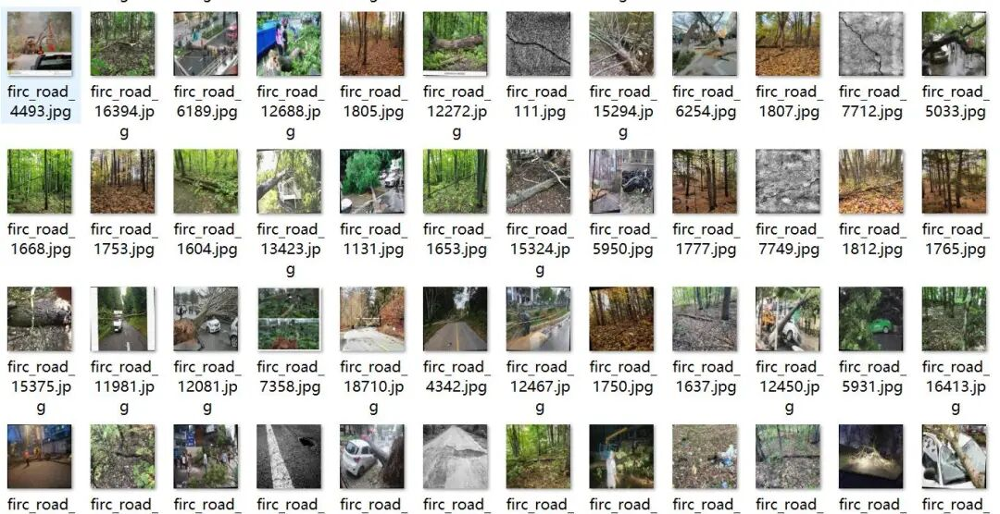
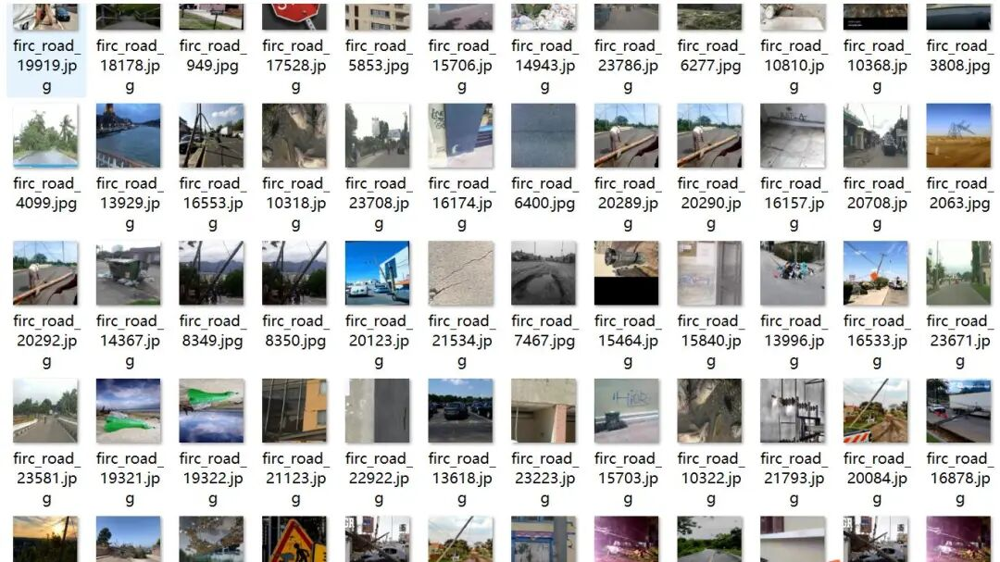
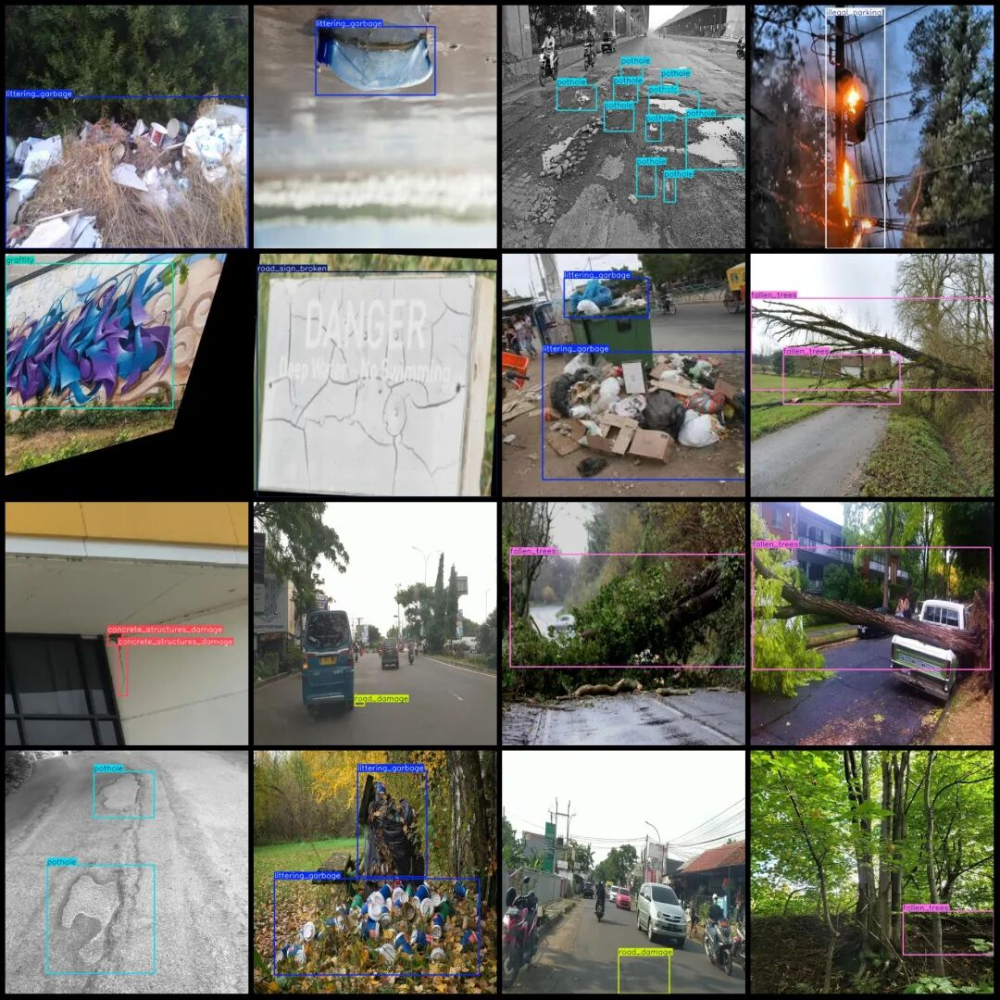
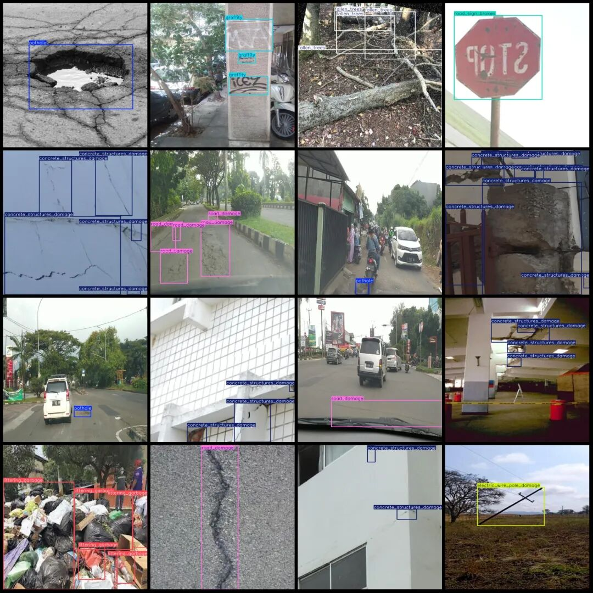

# Intelligent Transportation City Road Patrol Data Set - VOC+YOLO format with 24,000 images in 10 categories

Note: The dataset contains many image enhancements.

Dataset format: Pascal VOC format + YOLO format (txt file without split path, only contains jpg images and corresponding VOC format xml files and yolo format txt files)

Number of images (number of jpg files): 24000

Number of annotations (number of xml files): 24000

Number of annotations (number of txt files): 24000

Label category count: 10

Label category names (Note that the order of labels in YOLO format does not correspond to this, but is based on the classes.txt file in the labels folder): ["concrete_structures_damage", "dead_animal_pollution", "electric_wire_pole_damage", "fallen_trees", "graffity", "illegal_parking", "littering_garbage", "pothole", "road_damage", "road_sign_broken"]

Number of boxes labeled in each category:

concrete_structures_damage (Damage to concrete structure) Frame count = 11953

Dead Animal Pollution (Animal Carcass Pollution) Frame Count = 190

Electric Wire Pole Damage (Damage to Electric Poles or Wire) Frames = 3801

Fallen_trees (fallen trees) frame count = 5965

Graffiti (scribble) frame count = 4021

illegal_parking (illegal parking) frame count = 393

littering_garbage (Discarding rubbish) Frame count = 8218

Pothole (Pit) Frame Count = 11637

road_damage (Road Damage) box count = 4883

road_sign_broken (Broken Road Sign) Frames = 1036

Total frame count: 52097

Image resolution: 640x640

Using labelImg:

Annotation rules: Draw a rectangle around the category.

Important Notice: No

Special : This dataset does not guarantee the accuracy of the trained models or weight files.

Image Preview:

Annotation example:

## Payment

Here is a pay link on Stripe ( https://buy.stripe.com/3cs8yP7sY87d0vu9AB ). Please contact me lonlonago@foxmail.com after funding $89, and I will send you a complete data files , thank you!

